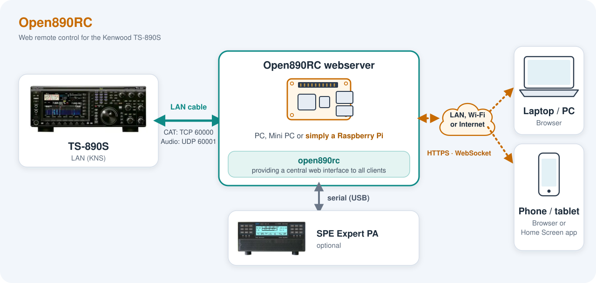
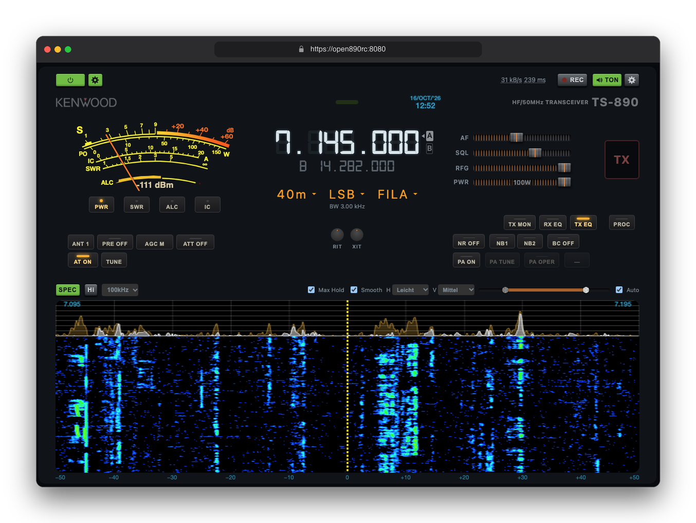
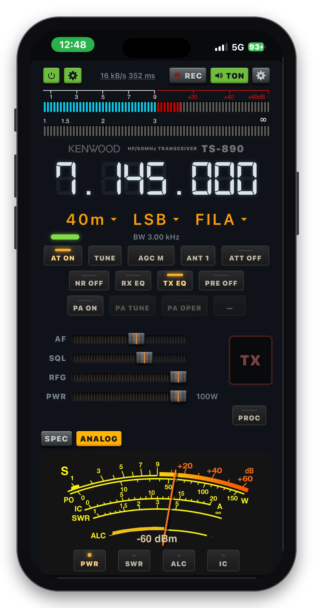
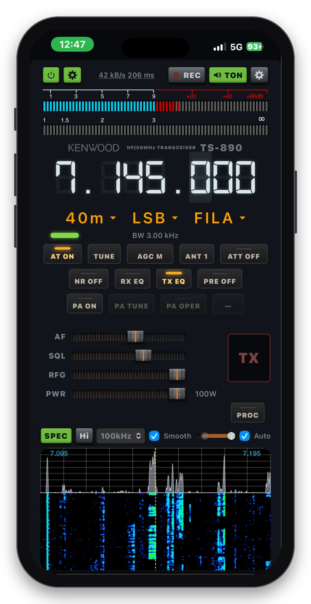
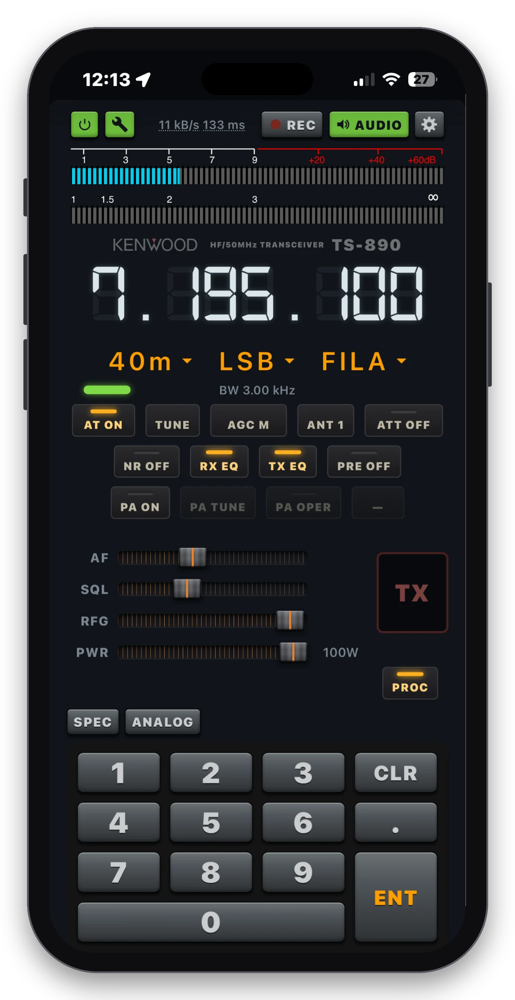
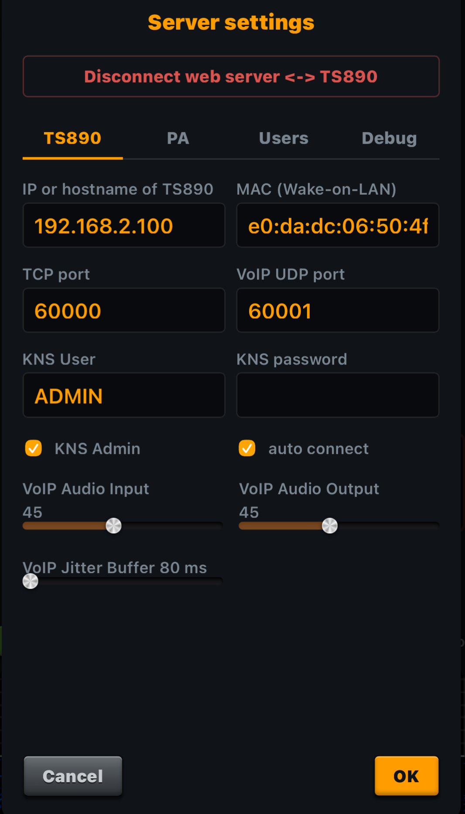
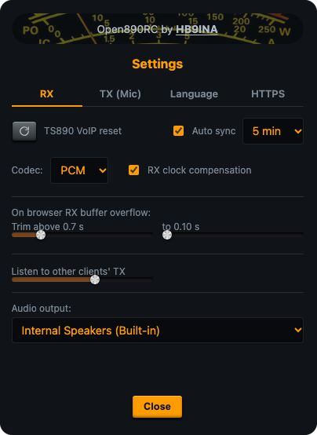
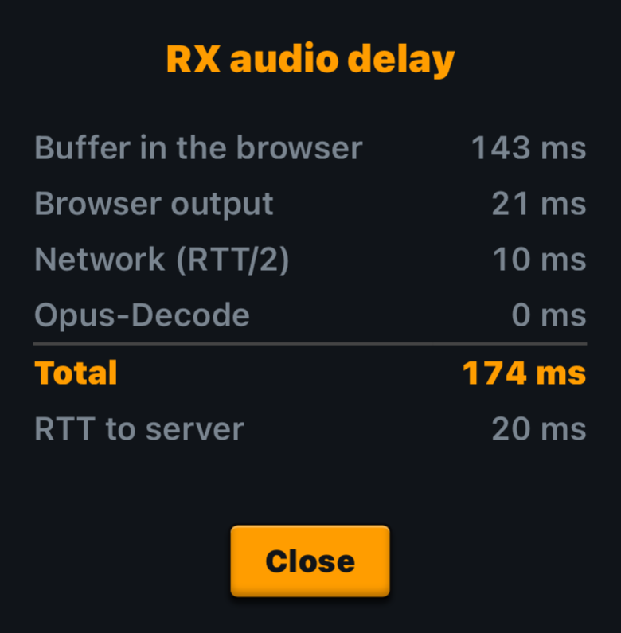

# Open890RC

Web remote control for the Kenwood TS-890S. One Go program (a single binary, the
web interface is built in) talks to the transceiver over the LAN (KNS) and gives
every browser in the network the full control. The TS-890 can be switched off and
woken up again remotely with a Wake-on-LAN magic packet.

Go is a language optimized for high performance, networking and scaling. It runs
happily on a Raspberry Pi next to the radio or your shack PC (Mac, Linux, Windows).

Open890RC expands the TS-890 with new features like AI based noise cancellation and seamless
integration of an SPE amplifier. Test it out!



We recommend connecting the TS-890 to the Pi/PC running the Open890RC server with
a cable. This ensures the fastest UDP/VoIP audio and reliable Wake-on-LAN.



<p>
  
  
  
</p>

Examples for Server Settings & Browser config:

<p>
  
  
  
</p>

## Features

- TS-890 power off/on (via Wake-on-LAN) 
- Frequency (digit wheel, direct entry, click/drag on the waterfall), mode, bands, VFO A/B
- AGC, ATT, preamp, antenna, NR, NB1/NB2 with their settings, beat canceller, RX/TX equalizer,
  speech processor, antenna tuner
- AI based noise reduction based on RNNoise project (the AI NR step of the NR button)
- Audio filters: width/shift, hi/lo cut, APF (CW), live graph of the passband
- S meter, power, SWR and ALC, as bars or as an analog needle instrument
- Band scope: spectrum and waterfall with max hold, smoothing and level controls
- RX audio in the browser (raw PCM or Opus), TX audio from the browser microphone
- Multiclient (several browsers at the same time sharing one radio session)
- Login for users outside the local network, admin and PA rights per user
- Interface languages: English, German, Italian, Spanish (chosen per browser)
- Optional SPE Expert 1.5K amplifier control over a serial port (on/off, standby/operate, power level, tune)

## What you need

- A TS-890S with KNS enabled and a KNS account set up on the radio.
  If the account is a KNS *administrator*, tick "KNS Admin" in the settings,
  otherwise the login is refused.
- A computer that stays on in the same network (a Raspberry Pi4 is ideal).
  No other software is needed.

## Quick start

1. Download or build the binary for your system (see below) and start it:

   ```sh
   ./open890rc
   ```

   Without any option it prints a short help. Everything can also be set later in
   the browser.

2. Open `https://<address-of-the-computer>:8080` in a browser. The first visit
   shows a certificate warning, see [HTTPS](#https).

3. Click the settings button (top left), enter the IP address of the TS-890, the
   KNS user and password, and connect. The server remembers the settings in
   `open890rc-config.json` (in the folder the program runs in).

Optional command line options (every `-kns…` option has an environment variable too):

| Option | Meaning |
|---|---|
| `-knsip`, `-knstcpport`, `-knsvoipport` | radio address, KNS port (60000) and VoIP port (60001) |
| `-knsuser`, `-knspass`, `-knsadm` | KNS login and whether it is an administrator account |
| `-speport`, `-spebaud` | serial port and baud rate of an SPE Expert amplifier |
| `-web` | address of the web interface, default `:8080` |
| `-config` | file with the remembered settings, default `open890rc-config.json` |
| `-no-tls` | plain HTTP instead of HTTPS (audio then only works from `localhost`) |

## HTTPS

All modern Browsers only allow audio playback and microphone access on secure pages,
so the server uses HTTPS. On first start it creates its own certificate authority
and a server certificate for the host name and all IP addresses of the machine.
To get rid of the browser warning, install that CA once on each device: open
**Settings** (gear next to AUDIO) → **HTTPS**, download the certificate and add
it to the trusted certificates of your system or browser. After that the warning
stays away, even when the server certificate is renewed (new IP address, expiry).

Keep `open890rc-ca.pem` and `open890rc-ca-key.pem` (created next to the program).
If they are lost, a new CA is made and has to be installed again.

## Building

You need Go (see `go.mod`). The program has no C dependencies, so it can be
cross compiled for every target:

```sh
go build -trimpath -ldflags="-s -w" -o open890rc ./cmd/open890rc

GOOS=linux   GOARCH=arm64 go build -o open890rc-pi  ./cmd/open890rc   # Raspberry Pi
GOOS=linux   GOARCH=amd64 go build -o open890rc-linux ./cmd/open890rc
GOOS=windows GOARCH=amd64 go build -o open890rc.exe ./cmd/open890rc
GOOS=darwin  GOARCH=arm64 go build -o open890rc-mac ./cmd/open890rc
```

## Use it as an app on the iPhone

Open Open890RC from the Home Screen like a normal app, without the Safari address bar:

1. Open `https://<address-of-the-computer>:8080` in **Safari** (not in another browser app).
   Install and trust the HTTPS certificate first, see [HTTPS](#https).
2. Tap the **Share** button (square with arrow) in the toolbar.
3. Scroll down and choose **Add to Home Screen**.
4. Keep the name or change it, switch **Open as Web App** on, then tap **Add**.
5. Start Open890RC from the new icon on the Home Screen.

Audio keeps playing when the screen is locked. Media buttons (headset, lock screen, CarPlay) are connected:
play/pause, and the skip buttons tune the frequency up or down by 1 kHz.

## Users and access

Browsers in the local network need no login and count as administrators.
Everybody else (for example over a VPN or the internet) has to log in with a user
that an administrator creates in the settings. Put the server behind your own
protection (VPN such as Tailscale, or a reverse proxy) before exposing it to the
internet, and use at least a strong password. There is no further authentication
inside the local network.

## License

Open890RC is released under the [MIT License](LICENSE). The licenses of the
third-party components it uses are collected in [THIRD_PARTY_LICENSES](THIRD_PARTY_LICENSES).
The Digital-7 font is the only part with a non-commercial restriction.

> **Disclaimer.** Open890RC is an unofficial, independent project. It is not
> made, endorsed or supported by Kenwood or JVCKENWOOD. Kenwood, TS-890 and all
> other product names, logos and trademarks belong to their respective owners
> and are used only to identify the equipment this software works with. Use it
> at your own risk; no warranty of any kind.

## Credits

- Protocol knowledge and reference: [open890](https://github.com/open890/open890)
  by Tony Collen (MIT license), whose work inspired this project, and its
  `kenwood-ts890` documentation.
- [Kenwood TS-890S PC command reference](https://www.kenwood.com/) for the CAT commands.
- [gorilla/websocket](https://github.com/gorilla/websocket) (BSD-3-Clause),
  [gopus](https://github.com/thesyncim/gopus) (BSD-3-Clause),
  [go-serial](https://github.com/bugst/go-serial) (BSD-3-Clause),
  [golang.org/x/sys](https://pkg.go.dev/golang.org/x/sys) (BSD-3-Clause).
- [RNNoise](https://github.com/xiph/rnnoise) (BSD-3-Clause, Xiph.Org) in the
  WebAssembly build of [@jitsi/rnnoise-wasm](https://github.com/jitsi/rnnoise-wasm) (Apache-2.0)
  for the optional RX noise suppression.
- The font *Digital-7* by Sizenko Alexander ([styleseven.com](http://www.styleseven.com/)),
  free for non-commercial use, for the frequency display.

73 de André HB9INA
