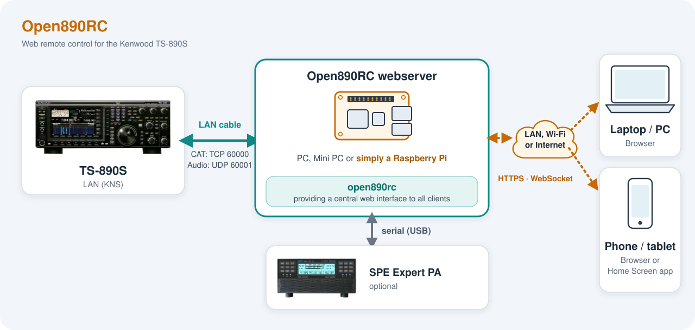
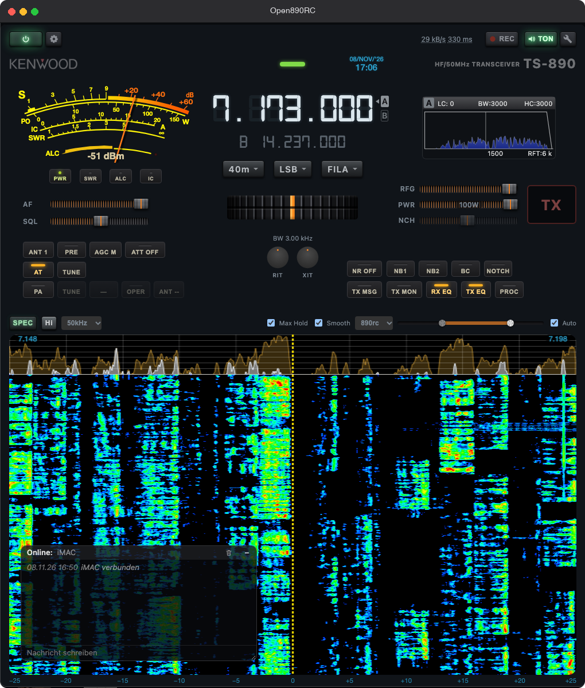

# Open890RC – Bedienungsanleitung

Web-Fernsteuerung für den Kenwood TS-890S. Ein einzelnes Programm läuft auf einem Raspberry Pi oder PC im selben Netz wie das Funkgerät, bedient wird per Browser (PC, Tablet, Handy).

## Inhalt

1. [Installation](#1-installation)
2. [Einrichtung](#2-einrichtung)
3. [Bedienung](#3-bedienung)
4. [Tastaturbelegung](#4-tastaturbelegung)

## 1. Installation



### 1.1 Voraussetzungen

| Was | Hinweis |
|---|---|
| **Kenwood TS-890S** | KNS (Kenwood Network System) am Funkgerät aktiviert, KNS-Benutzerkonto angelegt. Ist das Konto ein KNS-**Administrator**, muss später in Open890RC „KNS Admin" angehakt werden, sonst lehnt das Radio den Login ab. |
| **Server-Rechner** | Bleibt eingeschaltet, im selben Netz wie das TS-890. Ideal: Raspberry Pi 4 oder neuer. Auch möglich: Mac, Linux-PC, Windows-PC. |
| **Netzwerk** | Der Server sollte per **Kabel** am Netz bzw. direkt am LAN-Port des TS-890 hängen (schnellstes UDP/VoIP-Audio, zuverlässiges Wake-on-LAN). Die Browser dürfen im WLAN sein. **Achtung:** Der LAN-Port des TS-890 arbeitet nur mit **100 Mbit/s** (kein Gigabit). Bei Kabelverbindung die Netzwerkkarte des Raspberry Pi bzw. PCs fest auf 100 Mbit/s stellen, siehe [2.6](#26-eigenes-funknetz-setup-tipps). |
| **Browser** | Aktueller Chrome, Edge, Firefox oder Safari. Audio und Mikrofon funktionieren nur über HTTPS (siehe [HTTPS](#15-https-zertifikat-installieren)). |

Es wird keine weitere Software benötigt, auch kein ARCP-890.

### 1.2 Programm beschaffen

Fertige Pakete: <https://github.com/aneitzel/open890rc/releases>

| Datei | Für |
|---|---|
| `open890rc_pi_arm64.tar.gz` | Raspberry Pi (64-Bit-OS) |
| `open890rc_linux_x86-64.tar.gz` | Linux-PC |
| `open890rc_mac_universal.tar.gz` | macOS (Intel und Apple Silicon) |
| `open890rc_windows_x86-64.zip` | Windows |

`SHA256SUMS` enthält die Prüfsummen. Prüfen (Linux/macOS): `shasum -a 256 -c SHA256SUMS`.

Archiv in einen eigenen Ordner entpacken, z. B. `~/open890rc`. In diesem Ordner legt das Programm später seine Einstellungen, Benutzer und Zertifikate ab – der Ordner muss beschreibbar sein.

#### Selbst bauen (optional)

Go (Version siehe `go.mod`) installieren, dann im Quellordner:

```sh
go build -trimpath -ldflags="-s -w" -o open890rc ./cmd/open890rc
```

Cross-Compile ohne C-Abhängigkeiten:

```sh
GOOS=linux   GOARCH=arm64 go build -o open890rc-pi    ./cmd/open890rc   # Raspberry Pi
GOOS=linux   GOARCH=amd64 go build -o open890rc-linux ./cmd/open890rc
GOOS=windows GOARCH=amd64 go build -o open890rc.exe   ./cmd/open890rc
GOOS=darwin  GOARCH=arm64 go build -o open890rc-mac   ./cmd/open890rc
```

### 1.3 Erster Start

Linux/macOS: ausführbar machen und starten.

```sh
chmod +x open890rc
./open890rc
```

Windows: `open890rc.exe` im Ordner starten (Eingabeaufforderung oder Doppelklick).

macOS blockiert unsignierte Programme aus dem Internet. Falls das passiert: in der Konsole `xattr -d com.apple.quarantine open890rc`, oder im Finder Rechtsklick → Öffnen.

Ohne Optionen zeigt das Programm eine kurze Hilfe mit allen Kommandozeilen-Optionen und startet den Webserver auf Port **8080**. Alles Weitere wird im Browser eingestellt ([Einrichtung](#2-einrichtung)).

#### Kommandozeilen-Optionen

Alle `-kns…`-Optionen haben eine gleichnamige Umgebungsvariable.

| Option | Umgebungsvariable | Bedeutung |
|---|---|---|
| `-knsip` | `OPEN890RC_IP` | IP/Hostname des TS-890 |
| `-knstcpport` | `OPEN890RC_TCPPORT` | KNS-Steuerport, Standard 60000 |
| `-knsvoipport` | `OPEN890RC_VOIPPORT` | VoIP-/Audio-UDP-Port, Standard 60001 |
| `-knsuser`, `-knspass` | `OPEN890RC_USER`, `OPEN890RC_PASS` | KNS-Zugangsdaten |
| `-knsadm` | `OPEN890RC_ADMIN` | KNS-Konto ist Administrator (nur das Flag, **ohne Wert**; als Variable `true`) |
| `-speport`, `-spebaud` | `OPEN890RC_SPEPORT`, `OPEN890RC_SPEBAUD` | serielle Schnittstelle und Baudrate der SPE-Expert-PA |
| `-web` | – | Adresse des Webservers, Standard `:8080` |
| `-config` | – | Datei mit den gemerkten Einstellungen, Standard `open890rc-config.json` |
| `-usersfile` | – | Benutzerdatei, Standard `open890rc-users.json` |
| `-adduser LOGIN` | – | Benutzer auf der Konsole anlegen, danach beenden |
| `-no-tls` | – | Klartext-HTTP statt HTTPS (Audio dann nur von `localhost`) |
| `-tls-cert`, `-tls-key` | – | Pfade des erzeugten Zertifikats |

Beispiel:

```sh
./open890rc -knsip 192.168.1.201 -knsuser ADMIN -knspass geheim -knsadm -web :8080
```

Wichtig: `-knsadm` ist ein reiner Schalter. Wird ein Wert dahintergeschrieben (z. B. `-knsadm enabled`), hört Go an dieser Stelle auf, weitere Optionen zu lesen – `-web` wäre dann wirkungslos. Der Server gibt in diesem Fall eine Warnung aus.

### 1.4 Als Dienst auf dem Raspberry Pi

Im Ordner `deploy/` liegen eine systemd-Unit und ein Installationsskript.

1. Binary nach `/home/pi/open890rc/open890rc-pi` kopieren (Ordner `/home/pi/open890rc` anlegen, ausführbar machen).
2. Auf dem Pi: `sh deploy/install_service_pi.sh`

Das Skript kopiert `open890rc.service` nach `/etc/systemd/system/`, aktiviert und startet den Dienst. Die Unit startet das Programm neu, falls es abstürzt (`Restart=always`), und nimmt den Benutzer in die Gruppe `dialout` auf (für die serielle Schnittstelle der PA).

Nützliche Befehle:

```sh
systemctl status open890rc
sudo systemctl restart open890rc
journalctl -u open890rc -f
```

Zugangsdaten über Optionen/Umgebungsvariablen sind nicht nötig, der Dienst speichert sie nach der Einrichtung im Browser selbst in `open890rc-config.json`. Wer sie doch per Variable setzen will: in der Unit die Zeile `EnvironmentFile=` aktivieren.

### 1.5 HTTPS-Zertifikat installieren

Browser erlauben Audiowiedergabe und Mikrofon nur auf „sicheren" Seiten, deshalb läuft der Server über HTTPS. Beim ersten Start erzeugt er eine eigene Zertifizierungsstelle (CA) und ein Serverzertifikat für Rechnername und alle IP-Adressen des Rechners.

Ohne weitere Schritte zeigt der Browser beim ersten Besuch eine Zertifikatswarnung. Man kann sie einmalig bestätigen. Dauerhaft weg ist sie, wenn man die CA **einmal pro Gerät** installiert:

1. `https://<adresse-des-servers>:8080` öffnen (Warnung vorerst bestätigen).
2. Oben rechts **Client Einstellungen** öffnen (Schraubenschlüssel neben TON), Reiter **HTTPS**.
3. **CA-Zertifikat laden** (`open890rc-ca.crt`).
4. Das Zertifikat im System bzw. Browser als vertrauenswürdig installieren:
   - **iPhone/iPad:** Datei öffnen → „Profil geladen" → *Einstellungen → Allgemein → VPN & Geräteverwaltung* → Profil installieren; dann *Einstellungen → Allgemein → Info → Zertifikatsvertrauenseinstellungen* → Vertrauen für die Open890RC-CA einschalten.
   - **Android:** *Einstellungen → Sicherheit → Weitere Sicherheitseinstellungen → Von Speicher installieren → CA-Zertifikat*.
   - **macOS:** Datei doppelklicken, in der Schlüsselbundverwaltung öffnen, Eintrag doppelklicken → *Vertrauen* → „Immer vertrauen".
   - **Windows:** Doppelklick → *Zertifikat installieren* → Speicher „Vertrauenswürdige Stammzertifizierungsstellen".
   - **Firefox** nutzt einen eigenen Speicher: *Einstellungen → Datenschutz & Sicherheit → Zertifikate anzeigen → Zertifizierungsstellen → Importieren*.

Danach bleibt die Warnung aus, auch wenn das Serverzertifikat erneuert wird (neue IP, Ablauf).

**Wichtig:** `open890rc-ca.pem` und `open890rc-ca-key.pem` (liegen neben dem Programm) aufbewahren und sichern. Gehen sie verloren, entsteht eine neue CA, die auf allen Geräten erneut installiert werden muss. Wird der Server unter einem neuen Namen oder einer neuen IP erreichbar, erzeugt er das Serverzertifikat automatisch neu.

### 1.6 Als App auf dem Handy

Nach der Installation des Zertifikats lässt sich Open890RC wie eine App vom Home-Bildschirm starten (ohne Browserleiste).

**iPhone/iPad (Safari, nicht ein anderer Browser):**
1. `https://<adresse-des-servers>:8080` öffnen.
2. Teilen-Symbol → **Zum Home-Bildschirm** → „Als Web-App öffnen" einschalten → Hinzufügen.

**Android (Chrome):**
1. Seite öffnen, Menü (drei Punkte) → **App installieren** (oder „Zum Startbildschirm" → Installieren).

Der Ton läuft bei gesperrtem Bildschirm weiter. Die Medientasten (Kopfhörer, Sperrbildschirm, CarPlay) sind verbunden: Play/Pause, die Sprungtasten stimmen die Frequenz um 1 kHz hoch bzw. runter.

### 1.7 Firewall und Fernzugriff

- Auf dem Server-Rechner muss nur **TCP 8080** (bzw. der mit `-web` gewählte Port) für die Clients erreichbar sein. Die KNS-Ports 60000/60001 braucht nur der Server selbst, sie müssen **nicht** ins Internet weitergeleitet werden.
- Browser im lokalen Netz brauchen keinen Login und gelten als Administratoren. Von außen (VPN wie Tailscale, Internet) muss man sich mit einem Benutzerkonto anmelden (siehe [Einrichtung](#27-benutzer-und-rechte)).
- Das Programm hat keinen Schutz gegen Angriffe aus dem Internet über die Anmeldung hinaus. Vor einer Freigabe ins Internet ein VPN oder einen Reverse-Proxy davorschalten und starke Passwörter verwenden.

### 1.8 Aktualisieren und Deinstallieren

**Aktualisieren:** Dienst bzw. Programm beenden, das Binary ersetzen, wieder starten. Die Dateien `open890rc-config.json`, `open890rc-users.json` und die `*.pem`-Dateien bleiben unverändert erhalten (nicht überschreiben!). Danach die Seite im Browser neu laden (bei der Handy-App einmal ganz schließen und neu öffnen).

**Deinstallieren:** Dienst deaktivieren (`sudo systemctl disable --now open890rc`, Unit-Datei löschen), Ordner löschen. Ein installiertes CA-Zertifikat bei Bedarf in den Clients entfernen.

### 1.9 Probleme bei der Installation

| Problem | Ursache / Lösung |
|---|---|
| Seite nicht erreichbar | Adresse mit `https://` und Port (`:8080`) angegeben? Läuft der Server? Firewall? |
| Zertifikatswarnung bleibt | CA nicht (vollständig) als vertrauenswürdig installiert; bei iOS zusätzlich das Vertrauen in den Zertifikatsvertrauenseinstellungen einschalten. Nach einer Namens-/IP-Änderung neu laden. |
| Kein Ton / kein Mikrofon | Seite wird nicht über HTTPS geöffnet oder Zertifikat nicht akzeptiert. Mikrofon-Berechtigung im Browser erteilen. |
| `-web` wirkt nicht | Nach `-knsadm` keinen Wert angeben (siehe oben). |
| Port 8080 belegt | Anderen Port mit `-web :8081` wählen. Ports unter 1024 brauchen unter Linux Root-Rechte bzw. `setcap`. |


## 2. Einrichtung

### 2.1 Am TS-890 vorbereiten

1. Netzwerk des Funkgeräts einrichten (feste IP-Adresse empfohlen, damit die Adresse in Open890RC nicht jedes Mal wechselt).
2. **KNS** im Menü des Funkgeräts aktivieren und ein **KNS-Benutzerkonto** (Name, Passwort) anlegen.
3. Merken, ob das Konto ein KNS-**Administrator** ist. Dann muss später in Open890RC „KNS Admin" angehakt werden – sonst lehnt das Radio den Login ab.
4. Für Wake-on-LAN (Einschalten per Browser) muss das Funkgerät das Einschalten über das Netzwerk erlauben (Netzwerk-Einstellungen des TS-890).

Das KNS erlaubt nur **eine** aktive Verbindung gleichzeitig. Ist das Radio schon von ARCP-890 oder einer anderen Open890RC-Instanz belegt, wird der Login abgewiesen. Open890RC selbst teilt diese eine Verbindung an beliebig viele Browser auf.

### 2.2 Erste Verbindung herstellen

1. Browser öffnen: `https://<adresse-des-servers>:8080` (Zertifikatswarnung siehe [1.5](#15-https-zertifikat-installieren)).
2. Oben links das Zahnrad **Server Einstellungen** anklicken (nur für Administratoren sichtbar; Browser im lokalen Netz zählen als Administrator).
3. Reiter **TS890** ausfüllen (siehe unten).
4. **OK** drücken. Der Server verbindet sich, die Oberfläche wird aktiv, die Frequenz erscheint.

Die Einstellungen merkt sich der **Server** in `open890rc-config.json`; jeder weitere Browser sieht die Verbindung sofort und muss nichts eintragen.

### 2.3 Server Einstellungen

Oben im Fenster steht ein Umschalter: **Trenne WebServer ↔ TS890** (rot, solange verbunden) bzw. **Verbinde WebServer ↔ TS890** (grün, verbindet mit den eingetragenen Werten). Darunter vier Reiter.

#### Reiter TS890

| Feld | Bedeutung |
|---|---|
| IP or hostname of TS890 | Adresse des Funkgeräts |
| MAC (Wake-on-LAN) | Optional. Wird in der Regel automatisch ermittelt; nur eintragen, falls das Einschalten nicht klappt |
| TCP port | KNS-Steuerport, Standard 60000 |
| VoIP UDP port | Audio-Port, Standard 60001 |
| KNS User / KNS Passwort | Zugangsdaten des KNS-Kontos |
| KNS Admin | Haken setzen, wenn das Konto ein KNS-Administrator ist |
| auto connect | Einstellungen merken und beim Start des Servers automatisch verbinden |
| VoIP Audio Input / Output | Audiopegel am TS-890 für den VoIP-Strom (wirkt am Radio, für alle Clients) |
| VoIP Jitter Buffer | Puffer des Radios gegen Netzwerk-Schwankungen: 80 / 200 / 500 / 800 ms. Nur mit KNS-Admin-Konto einstellbar. Größer = stabiler, aber mehr Verzögerung |
| AUTO power OFF | Schaltet die Station nach so vielen Minuten ohne Nutzung automatisch aus (0 = aus) |

Hinweise:
- Pflichtfelder sind IP und User.
- „Verbinden" ohne Änderung bei bestehender Verbindung tut nichts – das Fenster schließt sich nur.
- Beim Verbinden schaltet der Server die TX-Audioquelle des Radios auf LAN (Front-Mikrofon aus) und den TX-Equalizer aus; beim Trennen, Radio-Abschalten und Beenden des Servers (Ctrl-C/SIGTERM) werden die ursprünglichen Werte wiederhergestellt. Bei einem unerwarteten Abbruch (Stromausfall, Absturz) geht nichts zurück – dann ggf. am Radio prüfen.

#### Reiter PA

Für eine **SPE Expert 1.5K** Endstufe über serielle Schnittstelle (USB-Seriell):

| Feld | Bedeutung |
|---|---|
| SPE Expert 1k5 COM port | Schnittstelle, z. B. `/dev/ttyUSB0`, `/dev/cu.usbserial-…`, `COM3`. Vorschläge erscheinen in der Liste |
| auto connect | Port merken, beim Start verbinden |
| verbinden / trennen | PA-Verbindung unabhängig vom Radio |
| PA TX (TimeOutTimer) | Sicherheitsabschaltung in Sekunden, falls TX hängen bleibt (0 = aus) |
| Max PWR bei aktiver PA | Leistungsbegrenzung des Transceivers (PWR) solange die PA an ist |

Unter Linux muss der Benutzer in der Gruppe `dialout` sein (beim systemd-Dienst bereits eingetragen). Ist die PA an, hält der Server das interne Antennentuner-AT des TS-890 ausgeschaltet und begrenzt die Sendeleistung.

#### Reiter Benutzer

Siehe [2.7 Benutzer und Rechte](#27-benutzer-und-rechte).

#### Reiter Debug

Live-Protokoll des Servers (mit Filterfeld und „auto scroll"). Nützlich zur Fehlersuche, z. B. bei Audio-Aussetzern oder abgelehnten Befehlen.

### 2.4 Client Einstellungen

Der Schraubenschlüssel neben **TON** (oben rechts) öffnet die Einstellungen, die **nur für diesen Browser** gelten (werden im Browser gespeichert).

#### Reiter RX

| Einstellung | Bedeutung |
|---|---|
| Codec | **PCM**: geringste Latenz, ca. 256 kbit/s, für LAN. **OPUS**: ca. 16 kbit/s, für Mobilfunk/Internet |
| VoIP reset (Kreispfeil) | Startet den VoIP-Strom des TS-890 neu. **Wirkt auf alle verbundenen Clients.** Hilft bei Aussetzern oder Kratzen |
| Tonausgabe auf | Ausgabegerät (nur Desktop-Browser; iOS wählt selbst) |
| Bei Browser-Pufferüberlauf: Kürzen ab / auf | Wächst der Rückstand im Browser-Puffer über „Kürzen ab", werden die ältesten Audiodaten verworfen und der Puffer auf „auf" gekürzt. Kleine Werte = geringe Verzögerung, aber öfter ein Sprung |
| TX anderer Clients mithören | Lautstärke, mit der man einen anderen sendenden Client hört (0 = aus) |
| VFO STEP mit Tastatur | Schrittweite der Pfeiltasten ←/→ (10 Hz … 100 kHz, Standard 100 Hz) |

#### Reiter TX (Mic)

| Einstellung | Bedeutung |
|---|---|
| Mikrofon | Eingabegerät. Bei Bluetooth-Kopfhörern das eingebaute Mikrofon wählen, um die Umschaltung ins Headset-Profil zu vermeiden |
| Mikrofon Empfindlichkeit | Verstärkung im Browser. Die Pegelanzeige darunter darf nicht dauerhaft im roten Bereich stehen, sonst klingt das Signal verzerrt. Auch das ALC des Radios beobachten |
| TX Mic Limiter + Voreinstellung | Fängt vereinzelte Pegelspitzen ab (Sanft / Stark) |
| Halte Bluetooth-/CarPlay-Hands-Free-Profile aktiv | Vermeidet lange Umschaltzeiten bei TX |
| TX-Taste Tastatur | Taste für Push-to-Talk (Leertaste, Shift, Zehnertastatur 0, Zehnertastatur Enter) |
| TX-Taste Funktionsweise | **TX wenn gedrückt** (nur senden, solange gehalten) oder **TX/RX umschalten** (ein Druck ein, nächster aus) |

Die Mikrofon-Berechtigung fragt der Browser beim ersten Senden. Ohne HTTPS (siehe 1.5) ist kein Mikrofonzugriff möglich.

#### Reiter Sprache

Oberflächensprache dieses Browsers: Deutsch, English, Italiano, Español.

#### Reiter HTTPS

Download des CA-Zertifikats (`open890rc-ca.crt`), siehe [1.5](#15-https-zertifikat-installieren).

### 2.5 Radio ein- und ausschalten

- **Einschalten:** Ist die Verbindung zum TS-890 nicht aktiv, versucht der Power-Button (oben links) zuerst eine direkte Verbindung. Schlägt das fehl, sendet der Server ein **Wake-on-LAN**-Paket und versucht es etwa eine Minute lang (20 × 3 s) erneut. Ohne bekannte MAC-Adresse gibt es eine Fehlermeldung.
- **Ausschalten:** Der Power-Button öffnet „Beenden" mit **Session beenden** (nur dieser Browser, Radio bleibt an) und **TS890 ausschalten**. Läuft die PA, wird sie vorher ausgeschaltet.
- **AUTO power OFF** (Server Einstellungen): automatische Abschaltung nach Nichtnutzung.

### 2.6 Eigenes Funknetz-Setup: Tipps

- Server per Kabel ans Radio/Netz, Clients dürfen im WLAN sein: der empfindliche UDP-Audiostrom läuft dann nur über Kabel.
- **100-Mbit/s-Port:** Das TS-890 hat nur einen 100-Mbit/s-Netzwerkanschluss, kein Gigabit. Wird der Server per Kabel angeschlossen (empfohlen), die Schnittstelle des Raspberry Pi bzw. PCs ebenfalls auf 100 Mbit/s (Vollduplex) stellen, damit die Aushandlung mit dem Radio stabil bleibt. Beispiele (Schnittstellenname ggf. anpassen):
  - Linux/Raspberry Pi: `sudo ethtool -s eth0 speed 100 duplex full autoneg on` (dauerhaft z. B. über NetworkManager: `nmcli connection modify "<Verbindung>" 802-3-ethernet.speed 100 802-3-ethernet.duplex full`, danach Verbindung neu starten)
  - macOS: *Systemeinstellungen → Netzwerk → Ethernet → Details → Hardware* → Konfiguration „Manuell", Geschwindigkeit 100baseT, Duplex „Vollduplex"
  - Windows: *Geräte-Manager → Netzwerkadapter → Eigenschaften → Erweitert → Geschwindigkeit & Duplex* → „100 Mbps Vollduplex"
  - Ein Switch dazwischen, der Gigabit und 100 Mbit/s vermittelt, erledigt das ebenfalls und ist die einfachste Lösung.
- Bei Fernzugriff über Internet/Mobilfunk Codec **OPUS** wählen.
- Treten Audioaussetzer auf, zuerst den **VoIP-Reset** probieren, dann den Jitter-Buffer erhöhen.
- Klingt der Empfang „metallisch", zuerst die DSP-Einstellungen am Radio prüfen (BC, NR, NB, Notch, APF, AGC), bevor am Audiopfad gesucht wird.

### 2.7 Benutzer und Rechte

- Browser im **lokalen Netz** (private Adressen) brauchen **keinen Login** und gelten als Administratoren.
- Alle anderen (VPN wie Tailscale, Internet) sehen eine **Login-Maske**. Ohne angelegte Benutzer kommt von außen niemand hinein. Nach 5 Fehlversuchen gibt es eine Sperre von 60 s. Die Sitzung gilt 12 Stunden und endet bei einem Neustart des Servers.
- Benutzer verwaltet man im Reiter **Benutzer** der Server Einstellungen (nur im lokalen Netz bzw. als Admin):
  - **Neuer Benutzer** oder Stift-Symbol zum Bearbeiten: Login (bis 8 Zeichen: Buchstaben, Ziffern, `.`, `_`, `-`), Name (frei, bis 40 Zeichen), Passwort (mindestens 6 Zeichen; beim Bearbeiten leer = unverändert), Rechte, Löschen.
  - Rechte: **Admin** (Server Einstellungen und Benutzerverwaltung sichtbar), **PA** (PA sehen und bedienen), **TX** (Senden erlaubt; fehlt es, ist der Benutzer „Listen-only").
  - **Login Nachricht**: Text, der Benutzern nach der Anmeldung angezeigt wird.
  - **Chatfunktion aktivieren**: schaltet den Chat für alle ein/aus.
- Passwortänderung oder Löschen beendet die Sitzungen dieses Benutzers.
- Ersteinrichtung ohne Zugang zum lokalen Netz: auf der Konsole des Servers `./open890rc -adduser LOGIN` (fragt Name, Admin und Passwort ab und beendet sich dann; den Server danach neu starten).
- Aktuell verbundene Clients sieht man im Fenster, das sich mit Klick auf die kB/s-Anzeige oben öffnet.

### 2.8 Gesicherte Dateien

Im Programmordner liegen: `open890rc-config.json` (Einstellungen inkl. KNS-Passwort), `open890rc-users.json` (Benutzer, Passwort-Hashes), `open890rc-ca*.pem` und `open890rc-cert/key.pem` (Zertifikate). Diese Dateien sichern und nicht weitergeben.

## 3. Bedienung

Die Oberfläche gibt es in zwei Layouts: **Desktop** (Fensterbreite ab 800 px, Zeigerinstrument, VFO A/B, Datum/Uhrzeit, Chat-Fenster im Wasserfall) und **Handy/Tablet** (schmal, Balkenmeter, Easy Mode). Die meisten Elemente sind in beiden gleich.



### 3.1 Aufbau der Oberfläche

Von oben nach unten:

1. **Kopfzeile:** links Power-Button und Server-Einstellungen (Zahnrad, nur Admins), in der Mitte die Statusmeldung sowie kB/s- und Latenzanzeige, rechts **REC**, **TON** und Client-Einstellungen.
2. **Meter:** S-Meter bzw. beim Senden Leistung, dazu SWR (Handy: Balken; Desktop: Zeigerinstrument mit Tasten PWR/SWR/ALC/IC).
3. **Frequenzanzeige** mit Band-, Mode- und Filter-Auswahl, Audio-Filteranzeige (BW/Shift) und Busy/TX-LED.
4. **Tastenzeilen** (AT, TUNE, AGC, ANT, ATT, PRE, NR, NB, BC, NOTCH, TX MSG, TX MON, EQ, PROC) und **Regler** (AF, SQL, RFG, PWR).
5. **TX-Taste.**
6. **Spektrum und Wasserfall** mit eigener Bedienzeile (SPEC, Span, Pegel, Farben).

Ist das Radio ausgeschaltet oder nicht verbunden, sind die Bedienelemente abgedunkelt und die Frequenz zeigt „OFF". Die Statuszeile nennt den Grund („TS890 OFF – Power ON über WoL?" bzw. „Keine Verbindung").

### 3.2 Frequenz einstellen

- **Ziffern:** Klick auf die **obere Hälfte** einer Ziffer erhöht, auf die **untere Hälfte** verringert die Frequenz um den Stellenwert dieser Ziffer. Mit dem **Mausrad** über den kHz-/Hz-Ziffern (rechts vom ersten Punkt) geht es in derselben Schrittweite; über den MHz-Ziffern ist das Mausrad bewusst abgeschaltet.
- **Pfeiltasten** ←/→ ändern die Frequenz in der Schrittweite aus den Client-Einstellungen (siehe [4](#4-tastaturbelegung)).
- **Tastenfeld:** Bei ausgeschaltetem Spektrum (SPEC aus) erscheint ein Zahlenfeld. Frequenz in MHz eintippen (Komma oder Punkt), **ENT** übernimmt, **CLR** löscht. Werte außerhalb des Bereichs zeigen eine Fehlermeldung.
- **Spektrum/Wasserfall:** Kurzer Klick stimmt auf die Stelle ab (gerundet auf 0,5 kHz). Mit dem Finger/der Maus **ziehen** verschiebt die Frequenz live in 0,5-kHz-Schritten.
- **Drehrad** (Desktop unter RIT/XIT, am Handy im Easy Mode): ziehen und anschubsen, das Rad läuft nach. Doppelklick bzw. Doppeltipp öffnet Schrittweite, Auslauf und Schwergängigkeit.
- **Handy-Medientasten** (Sperrbildschirm, Kopfhörer): Titel vor/zurück = ±1 kHz.
- **Band** und **Mode** wählt man über die Auswahlmenüs; das Band folgt aus der Frequenz.
- **VFO A/B** (nur Desktop): die Kästchen A und B hinter den Ziffern schalten den aktiven VFO um.
- **RIT/XIT:** der Drehknopf neben der Frequenz schaltet ein/aus, Drehen stellt den Versatz ein, langer Druck setzt zurück.

### 3.3 Audio-Filter

Die Zeile unter der Frequenz zeigt Bandbreite und Shift. **Langer Druck** auf die Audioscope (oder die Filteranzeige) öffnet **Filter Einstellungen**:

- **Filter wählen** (FIL 1/2/3): jeder Filter merkt sich seine eigene Breite.
- **Breite** und **Shift** (CW, SSB im Shift/Width-Modus) bzw. **LC/HC** (Lo-/Hi-Cut; AM/FM und SSB im Hi/Lo-Cut-Modus). Die Regler wirken live, Werte rasten auf die echten Radiowerte ein.
- **SSB Filter Mode** schaltet das Radiomenü zwischen Hi/Lo-Cut und Shift/Width um (bleibt am Radio bestehen).
- **APF** (nur CW): an/aus, Shift ±200 Hz, Breite NAR/MID/WIDE, Gain.
- Eine Grafik zeigt das Durchlassband live.

### 3.4 Tasten und lange Druckzeit

Tasten leuchten, wenn die Funktion aktiv ist. **Kurzer Druck** schaltet um, **langer Druck (ca. 0,5 s)** öffnet bei einigen Tasten die Einstellungen:

| Taste | Kurzer Druck | Langer Druck |
|---|---|---|
| **AT** | Interner Antennentuner ein/aus (bei aktiver PA gesperrt) | – |
| **TUNE** | Tuning-Zyklus starten/abbrechen (bei aktiver PA gesperrt) | – |
| **AGC** | AGC OFF → S → M → F | – |
| **ANT** | Antenne 1 → 2 → 3 | – |
| **ATT** | Eingangsdämpfung OFF / 6 / 12 / 18 dB | – |
| **PRE** | Vorverstärker OFF / 1 / 2 | – |
| **NR** | OFF → NR1 → NR2 → **AI NR** (KI-Rauschunterdrückung im Browser, RNNoise) → OFF. In FM nur OFF/NR1 | Einstellungen Noise Reduction |
| **NB1 / NB2** | Noise Blanker ein/aus | Level, bei NB2 zusätzlich Typ A/B, Tiefe, Breite |
| **BC** | Beat Canceller (Autonotch) ein/aus | – |
| **NOTCH** | Manueller Notch ein/aus (nicht in AM/FM) | Breite N → M → W |
| **TX MSG** | Gewählte TX-Nachricht senden | Fenster **TX Nachrichten** |
| **TX MON** | TX-Monitor ein/aus | Monitor-Einstellungen |
| **RX EQ / TX EQ** | Equalizer ein/aus (TX EQ nicht in CW/FSK/PSK) | Effektauswahl (High Boost, Formant Pass, Bass Boost, Conventional, User …) |
| **PROC** | Sprachprozessor ein/aus | Fenster **TX-Processor** (Typ, Input, Output) |
| **Zeigerinstrument** | – | Nadel-Einstellungen (Trägheit, Spitzenwert halten, Rückgang) |

Der Server schaltet beim Verbinden den TX-Equalizer ab, damit die Fernsteuerung nicht gefärbt klingt. Schaltet man ihn selbst ein, bleibt er für die Sitzung an.

### 3.5 Regler

| Regler | Funktion |
|---|---|
| **AF** | Lautstärke **in diesem Browser** (nicht am Radio) |
| **SQL** | Squelch |
| **RFG** | RF-Gain (nach links reduzieren; in FM nicht einstellbar) |
| **PWR** | Sendeleistung (mindestens 5 W; bei aktiver PA nach oben begrenzt) |
| **NOTCH** | Position des manuellen Notch |
| **MIC / PROC** | Bei PROC aus: Mikrofonempfindlichkeit dieses Browsers; bei PROC an: Processor-Level |

Alle Regler lassen sich mit der Maus ziehen, mit dem Mausrad bewegen (in Schritten) und per Tastatur (Pfeiltasten) verstellen.

### 3.6 Meter

- **Empfang:** S-Meter. **Senden:** Leistung (Desktop-Tasten PWR/SWR/ALC/IC wählen, was die Nadel zeigt; im Balkenmodus werden mehrere Balken gezeigt).
- Bei aktiver PA zeigt der Balken die PA-Leistung und das PA-SWR; das Zifferblatt wechselt auf 0–1000 W bzw. 0–1500 W.
- Das ALC ist beim Aufnehmen und Testen von TX-Nachrichten die wichtigste Pegelanzeige.

### 3.7 Audio hören

1. **TON** (oben rechts) schaltet den RX-Ton dieses Browsers ein/aus. Auf iPhone startet er mit der ersten Berührung der Seite.
2. Der Codec (PCM/OPUS) steht in den Client-Einstellungen.
3. Die Anzeigen daneben: **kB/s** (Gesamt-Datenverkehr zum Browser; Klick zeigt die Aufteilung und die verbundenen Clients) und **ms** (Audioverzögerung Server → Wiedergabe; Klick öffnet Details). Eine Warnung in der Statuszeile meldet VoIP-UDP-Paketverluste.
4. **REC** nimmt den RX-Ton (beim Senden auch den eigenen TX-Ton) auf. Zweiter Klick beendet und lädt die Datei herunter, **Esc** bricht ab und verwirft.

### 3.8 Senden

1. **TX-Taste** gedrückt halten (oder je nach Einstellung antippen) bzw. die TX-Taste der Tastatur ([4](#4-tastaturbelegung)). Der Browser fragt beim ersten Mal nach dem Mikrofon.
2. Beim Senden ist das RX-Audio dieses Browsers stumm. Es sendet immer nur **ein** Client; während fremdes TX läuft, tut die TX-Taste anderer Clients nichts.
3. Aufpassen auf die Aussteuerung: ALC-Anzeige nicht übersteuern, Mikrofon-Pegel in den Client-Einstellungen anpassen.
4. Fehlt einem Benutzer das **TX-Recht**, kann er nur hören.
5. **TUNE** startet den Tuner, ohne dass das Mikrofon geöffnet wird.

#### TX Nachrichten (Sprachspeicher)

Langer Druck auf **TX MSG** öffnet das Fenster mit sechs Kanälen: **REC** nimmt über das Browser-Mikrofon auf (ALC-Anzeige beachten, restliche Aufnahmezeit wird angezeigt), **PLAY** hört lokal ab, **SEND** sendet tatsächlich, **STOP** bricht ab, **DELETE** löscht den Kanal, pro Kanal gibt es „Wiederholen". Die Funktion ist noch nicht ausgereift.

### 3.9 Spektrum und Wasserfall

Die Zeile unter dem Wasserfall:

- **SPEC** schaltet das Spektrum ein/aus (aus = weniger Datenverkehr, stattdessen erscheint das Frequenz-Tastenfeld).
- **Span:** angezeigte Breite (5 … 500 kHz).
- **Pegelregler (Floor/Ceiling):** linker Griff = Nullpunkt/Rauschboden, rechter Griff = Kontrast. **Auto** ermittelt den Floor automatisch.
- **Farbschema:** o890rc oder die wfview-Paletten (Jet, Cold, Hot, …).
- Desktop zusätzlich: **Smooth** (Glättung), Geschwindigkeit (Hi/Mid/Lo), Max Hold, Skala mit dem Abstand zur Mitte in kHz unter dem Wasserfall.
- Die gelbe gestrichelte Linie ist die VFO-Frequenz in der Bildmitte.

### 3.10 Chat

Die verbundenen Clients können sich schreiben (wenn ein Admin den Chat nicht abgeschaltet hat):

- **Desktop:** kleine Pille „Chat · N" unten links im Wasserfall; Klick öffnet das Fenster (verschiebbar, Größe an der unteren rechten Ecke). Enter sendet (max. 200 Zeichen). Das Fenster öffnet sich bei einer neuen Nachricht von selbst.
- **Handy:** Der Chat ersetzt den Wasserfallbereich. Er öffnet sich bei Nachrichten anderer Clients (das Spektrum wird dann abgeschaltet und beim Schließen mit „−" wieder eingeschaltet). Von Hand mit der Taste **CHAT** (rechts neben EASY MODE, nur bei ausgeschaltetem SPEC).
- **Admins** können einzelne Zeilen mit „×" und den ganzen Chat über das Papierkorb-Symbol löschen.
- Der Verlauf (letzte 50 Einträge) bleibt auf dem Server erhalten.

### 3.11 Handy: ANALOG, EASY MODE

Bei ausgeschaltetem SPEC erscheinen unter der Statuszeile die Tasten **ANALOG** (Zeigerinstrument statt Wasserfall) und **EASY MODE**: ein Vollbild mit großer Frequenz, Zeigerinstrument, Drehrad und riesiger TX-Taste, gedacht für die Bedienung mit einer Hand. Beenden mit dem ✕ oben rechts.

### 3.12 PA (SPE Expert 1.5K)

Ist die PA verbunden (und der Benutzer berechtigt), erscheint eine PA-Zeile:

| Taste | Funktion |
|---|---|
| **PA** (ein/aus) | PA ein-/ausschalten (nach dem Einschalten dauert es einige Sekunden) |
| **OPER** | Umschalten Standby ↔ Operate |
| **LOW / MID / HIGH** | Leistungsstufe, jeder Druck schaltet zur nächsten (Skalenende 1000 / 1000 / 1500 W) |
| **TUNE** | PA-Antennenanpassung (nur in Standby; das Radio sendet dazu kurz einen CW-Träger mit 10 W, zweiter Klick bricht ab) |
| **ANT** | SPE-Antenne umschalten (falls an der PA eingerichtet) |

Warnungen und Alarme der PA erscheinen in der Statuszeile (orange). Bei aktiver PA ist der interne Tuner gesperrt und die Leistung begrenzt (PWR zeigt „…W DRV"). Die PA-Funktionen sind nur mit Hardware getestet, soweit sie vorhanden war – bei Abweichungen bitte melden.

### 3.13 Sitzung beenden

Der Power-Button öffnet „Beenden": **Session beenden** trennt nur diesen Browser (Mikrofon, Ton und Spektrum werden gestoppt, bei einem Remote-Login erfolgt die Abmeldung; das Fenster schließt sich, soweit der Browser es erlaubt – sonst Fenster von Hand schließen), das Radio bleibt an. **TS890 ausschalten** fährt das Radio (und vorher die PA) herunter.

### 3.14 Statusmeldungen

| Meldung | Bedeutung |
|---|---|
| Keine Verbindung zum Web-Server… | WebSocket zum Server unterbrochen, Seite verbindet sich selbst neu |
| TS890 OFF – Power ON über WoL? | Radio nicht verbunden/aus. Power-Button drücken |
| ⚠ TS890: … ⚠ | Fehlermeldung des Radios (z. B. Temperatur, TX-Schutz, Referenzsignal) |
| ⚠ PA: … ⚠ | Warnung/Alarm der Endstufe |
| VoIP UDP Paketverluste | Pakete zwischen Radio und Server gingen verloren (Netzwerk prüfen, VoIP-Reset) |
| PA-Hinweise (PA EIN, OPERATING …) | Verschwinden nach 5 s |

### 3.15 Fehlersuche im Betrieb

| Symptom | Maßnahme |
|---|---|
| Ton wird verzögert / hängt zurück | Client-Einstellungen → RX: Pufferkürzung (Kürzen ab/auf) kleiner stellen; Netzwerk prüfen |
| Knacken, Aussetzer | VoIP-Reset; Jitter-Buffer erhöhen; Server per Kabel anbinden; Codec OPUS bei schwacher Verbindung |
| Metallischer Klang | Am Radio BC/NR/NB/Notch/APF/AGC prüfen |
| Ton nach TX leise (iPhone) | Der Browser startet den RX-Ton nach TX automatisch neu; sonst TON aus/an |
| Login am Radio abgelehnt | KNS Admin-Haken passend zum Konto; KNS-Verbindung nicht von ARCP-890 belegt |
| Kein Mikrofon | HTTPS verwenden, Berechtigung im Browser erteilen, Gerät in TX (Mic) wählen |
| Verzerrtes TX-Signal | Mikrofon-Pegel senken, Limiter aktivieren, ALC prüfen |

## 4. Tastaturbelegung

Die Tastaturkürzel gelten in Desktop-Browsern. Sie sind **inaktiv**, solange man in ein Textfeld, Auswahlfeld oder Eingabefeld tippt. Mit Strg/Ctrl, Alt oder Cmd gedrückt reagiert nichts, damit Browser-Kürzel (z. B. Strg+T) nicht stören.

### Übersicht

| Taste | Funktion |
|---|---|
| **←** / **→** | VFO abstimmen (Schrittweite einstellbar) |
| **Leertaste** (einstellbar) | PTT: Senden |
| **F** | Filter weiterschalten A → B → C → A |
| **R** | Aufnahme (REC) starten, nochmal **R** stoppt und speichert |
| **A** | Antennentuner (AT) ein/aus |
| **N** | Antenne weiterschalten (ANT); bei eingeschalteter PA die Antenne der PA (ANT neben PA TUNE) |
| **T** | TUNE starten (Abstimmzyklus des Antennentuners) |
| **P** | Processor (PROC) ein/aus |
| **Esc** | Fenster schließen, Aufnahme abbrechen, TX-Nachricht beenden |
| **0 … 9**, **,**, **Enter** | Frequenz eintippen (Tastenfeld) |

**F, R, T, A, N, P** wirken nur mit Radioverbindung und ohne offenes Fenster. **R** braucht laufenden RX-Ton, **T** und **A** sind gesperrt, wenn die jeweilige Taste im Bild ausgegraut ist (z. B. bei eingeschalteter PA oder ohne TX-Recht).

### 4.1 Abstimmen

| Taste | Funktion | Bedingung |
|---|---|---|
| **←** | Frequenz um eine Schrittweite **verringern** | Radio verbunden, kein Fenster offen |
| **→** | Frequenz um eine Schrittweite **erhöhen** | wie oben |

Die Schrittweite stellt man in **Client Einstellungen → RX → VFO STEP mit Tastatur** ein (10 Hz, 50 Hz, 100 Hz = Standard, 500 Hz, 1 kHz, 5 kHz, 10 kHz, 100 kHz). Sie gilt für diesen Browser.

### 4.2 Senden (PTT)

Eine Taste schaltet den Sender, solange sie gehalten wird (bei der Betriebsart „TX/RX umschalten" gilt das Verhalten der TX-Taste entsprechend). Welche Taste, wählt man in **Client Einstellungen → TX (Mic) → TX-Taste Tastatur**:

| Auswahl | Taste |
|---|---|
| Leertaste (Standard) | **Space** |
| Shift | linke oder rechte **Shift**-Taste |
| Zehnertastatur 0 | **Num 0** |
| Zehnertastatur Enter | **Num Enter** |

Sicherheitsregeln:
- Loslassen beendet TX immer. Verliert die Seite den Fokus oder wird der Tab verborgen, geht der Sender sofort auf Empfang.
- Kein PTT, wenn man in ein Textfeld tippt, ohne Radioverbindung, ohne TX-Recht, während eines Tuning-Zyklus oder wenn ein Fenster offen ist.
- **Ausnahme:** Bei offenen Tonfenstern (Equalizer, Noise Reduction, Noise Blanker, TX-Monitor, Processor, Filter, Client Einstellungen, Easy Mode) funktioniert PTT weiter, damit man Änderungen live beim Senden hören kann.
- Läuft TX schon (z. B. mit der Maus gestartet), startet die Taste nicht ein zweites Mal.

### 4.3 Tastenfeld für die Frequenzeingabe

Das Zahlenfeld erscheint bei ausgeschaltetem Spektrum (SPEC aus) und kann auch mit der Tastatur bedient werden (kein Fenster offen):

| Taste | Funktion |
|---|---|
| **0 … 9** | Ziffer eingeben (MHz) |
| **,** oder **.** | Dezimaltrenner |
| **Enter** | Frequenz übernehmen (ENT) |
| **Rücktaste** | letztes Zeichen löschen (BACK) |
| **Esc** | Eingabe löschen (CLR) |

### 4.4 Abbrechen und Schließen

| Taste | Funktion |
|---|---|
| **Esc** | Schließt das gerade offene Fenster (Server Einstellungen, Client Einstellungen, Beenden, Benutzer bearbeiten, Rückfrage, Netzwerk-Traffic, Latenz, …) |
| **Esc** | Bricht eine laufende **Aufnahme (REC)** ab und verwirft sie |
| **Esc** | Beendet eine gerade laufende **TX-Nachricht** |
| **Esc** (im Chat-Eingabefeld) | Verlässt das Eingabefeld |

### 4.5 Chat und Formulare

| Taste | Funktion |
|---|---|
| **Enter** (Chat-Eingabefeld) | Nachricht senden |
| **Enter** (Filterfeld im Debug-Reiter) | wird ignoriert, das Formular wird nicht abgeschickt |
| **Enter** (Benutzername-Feld u. ä.) | übernimmt die Eingabe |

### 4.6 Regler und Equalizer

| Bedienung | Funktion |
|---|---|
| **Pfeiltasten** auf einem fokussierten Regler | feiner Schritt |
| **Mausrad** über einem Regler | Schritte (±5) |
| **↑ / →** im Equalizer-Editor | Band um einen Schritt anheben |
| **↓ / ←** im Equalizer-Editor | Band um einen Schritt absenken |
| **Doppelklick** auf ein Equalizer-Band | Band auf 0 dB |

### 4.7 Maus- und Touch-Bedienung (zum Vergleich)

| Aktion | Funktion |
|---|---|
| Klick obere/untere Ziffernhälfte | Frequenz ± Stellenwert |
| Mausrad über kHz-/Hz-Ziffern | Frequenz ± Stellenwert |
| Klick im Wasserfall | Abstimmen auf die Stelle (0,5 kHz) |
| Ziehen im Wasserfall | Frequenz live verschieben |
| Langer Druck (0,5 s) auf NR, NB1/NB2, NOTCH, TX MSG, TX MON, TX EQ, RX EQ, PROC, Audioscope, Zeigerinstrument | Einstellungsfenster bzw. Breite (NOTCH) |
| Doppelklick auf Drehrad | Drehrad-Einstellungen |
| Langer Druck auf RIT/XIT-Knopf | Versatz zurücksetzen |

### 4.8 Medientasten (Handy/Kopfhörer/Sperrbildschirm)

| Taste | Funktion |
|---|---|
| Play / Pause | RX-Ton starten / stoppen |
| Titel vor / Vor-Sprung | Frequenz **+1 kHz** |
| Titel zurück / Zurück-Sprung | Frequenz **−1 kHz** |

Die Anzeige im „Jetzt läuft"-Bereich zeigt Frequenz und Mode sowie Filter und Breite.
