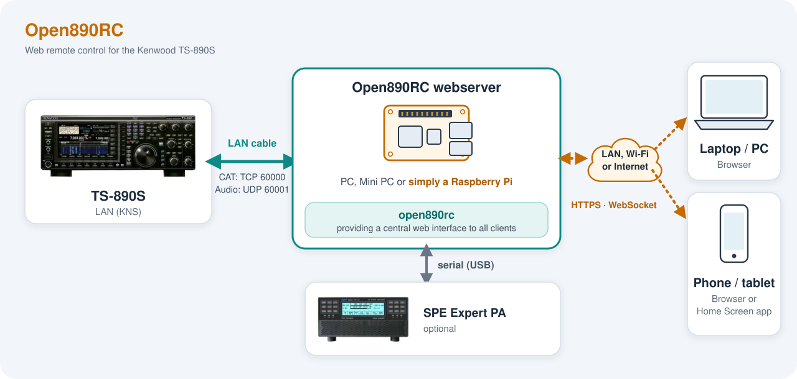
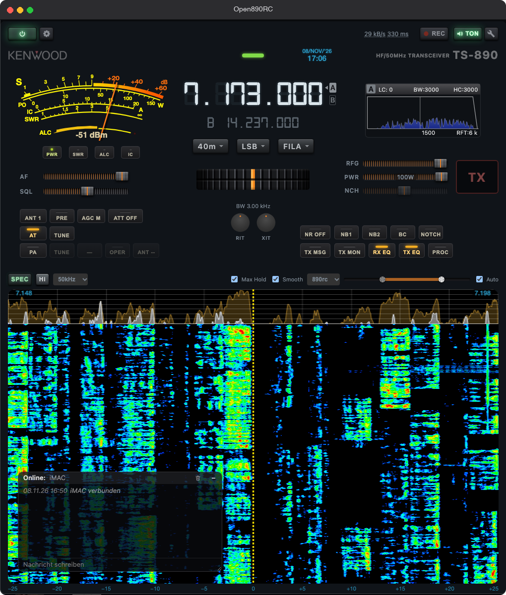

# Open890RC – User Guide

Web remote control for the Kenwood TS-890S. A single program runs on a Raspberry Pi or PC in the same network as the transceiver, and is operated from a browser (PC, tablet, phone).

## Contents

1. [Installation](#1-installation)
2. [Setup](#2-setup)
3. [Operation](#3-operation)
4. [Keyboard shortcuts](#4-keyboard-shortcuts)

## 1. Installation



### 1.1 Requirements

| What | Notes |
|---|---|
| **Kenwood TS-890S** | KNS (Kenwood Network System) enabled on the transceiver, KNS user account created. If the account is a KNS **administrator**, "KNS Admin" must later be ticked in Open890RC, otherwise the radio rejects the login. |
| **Server computer** | Stays switched on, in the same network as the TS-890. Ideal: Raspberry Pi 4 or newer. Also possible: Mac, Linux PC, Windows PC. |
| **Network** | The server should be connected by **cable** to the network or directly to the LAN port of the TS-890 (fastest UDP/VoIP audio, reliable Wake-on-LAN). The browsers may be on Wi-Fi. **Note:** the LAN port of the TS-890 only works at **100 Mbit/s** (no gigabit). When using a cable, set the network interface of the Raspberry Pi or PC to a fixed 100 Mbit/s, see [2.6](#26-tips-for-your-own-radio-network-setup). |
| **Browser** | Current Chrome, Edge, Firefox or Safari. Audio and microphone only work over HTTPS (see [HTTPS](#15-installing-the-https-certificate)). |

No other software is needed, not even ARCP-890.

### 1.2 Getting the program

Ready-made packages: <https://github.com/aneitzel/open890rc/releases>

| File | For |
|---|---|
| `open890rc_pi_arm64.tar.gz` | Raspberry Pi (64-bit OS) |
| `open890rc_linux_x86-64.tar.gz` | Linux PC |
| `open890rc_mac_universal.tar.gz` | macOS (Intel and Apple Silicon) |
| `open890rc_windows_x86-64.zip` | Windows |

`SHA256SUMS` contains the checksums. Verify (Linux/macOS): `shasum -a 256 -c SHA256SUMS`.

Unpack the archive into a folder of its own, e.g. `~/open890rc`. The program later stores its settings, users and certificates in this folder – it must be writable.

#### Building it yourself (optional)

Install Go (version see `go.mod`), then in the source folder:

```sh
go build -trimpath -ldflags="-s -w" -o open890rc ./cmd/open890rc
```

Cross-compiling without C dependencies:

```sh
GOOS=linux   GOARCH=arm64 go build -o open890rc-pi    ./cmd/open890rc   # Raspberry Pi
GOOS=linux   GOARCH=amd64 go build -o open890rc-linux ./cmd/open890rc
GOOS=windows GOARCH=amd64 go build -o open890rc.exe   ./cmd/open890rc
GOOS=darwin  GOARCH=arm64 go build -o open890rc-mac   ./cmd/open890rc
```

### 1.3 First start

Linux/macOS: make it executable and start it.

```sh
chmod +x open890rc
./open890rc
```

Windows: start `open890rc.exe` in the folder (command prompt or double-click).

macOS blocks unsigned programs downloaded from the internet. If that happens: in the console run `xattr -d com.apple.quarantine open890rc`, or in Finder right-click → Open.

Without options the program shows a short help listing all command-line options and starts the web server on port **8080**. Everything else is configured in the browser ([Setup](#2-setup)).

#### Command-line options

All `-kns…` options have an environment variable of the same name.

| Option | Environment variable | Meaning |
|---|---|---|
| `-knsip` | `OPEN890RC_IP` | IP/hostname of the TS-890 |
| `-knstcpport` | `OPEN890RC_TCPPORT` | KNS control port, default 60000 |
| `-knsvoipport` | `OPEN890RC_VOIPPORT` | VoIP/audio UDP port, default 60001 |
| `-knsuser`, `-knspass` | `OPEN890RC_USER`, `OPEN890RC_PASS` | KNS credentials |
| `-knsadm` | `OPEN890RC_ADMIN` | KNS account is an administrator (flag only, **no value**; as a variable `true`) |
| `-speport`, `-spebaud` | `OPEN890RC_SPEPORT`, `OPEN890RC_SPEBAUD` | serial port and baud rate of the SPE Expert PA |
| `-web` | – | Address of the web server, default `:8080` |
| `-config` | – | File with the remembered settings, default `open890rc-config.json` |
| `-usersfile` | – | User file, default `open890rc-users.json` |
| `-adduser LOGIN` | – | Create a user on the console, then exit |
| `-no-tls` | – | Plain HTTP instead of HTTPS (audio then only from `localhost`) |
| `-tls-cert`, `-tls-key` | – | Paths of the generated certificate |

Example:

```sh
./open890rc -knsip 192.168.1.201 -knsuser ADMIN -knspass secret -knsadm -web :8080
```

Important: `-knsadm` is a pure switch. If a value is written after it (e.g. `-knsadm enabled`), Go stops reading further options at that point – `-web` would then have no effect. The server prints a warning in this case.

### 1.4 As a service on the Raspberry Pi

The `deploy/` folder contains a systemd unit and an installation script.

1. Copy the binary to `/home/pi/open890rc/open890rc-pi` (create the folder `/home/pi/open890rc`, make the file executable).
2. On the Pi: `sh deploy/install_service_pi.sh`

The script copies `open890rc.service` to `/etc/systemd/system/`, enables and starts the service. The unit restarts the program if it crashes (`Restart=always`) and adds the user to the `dialout` group (for the serial port of the PA).

Useful commands:

```sh
systemctl status open890rc
sudo systemctl restart open890rc
journalctl -u open890rc -f
```

Credentials via options/environment variables are not needed; after setup in the browser the service stores them itself in `open890rc-config.json`. If you still want to set them via variables: enable the `EnvironmentFile=` line in the unit.

### 1.5 Installing the HTTPS certificate

Browsers only allow audio playback and microphone on "secure" pages, which is why the server runs over HTTPS. On first start it creates its own certificate authority (CA) and a server certificate for the hostname and all IP addresses of the computer.

Without further steps the browser shows a certificate warning on the first visit. You can confirm it once. It disappears permanently if you install the CA **once per device**:

1. Open `https://<server-address>:8080` (confirm the warning for now).
2. At the top right open **Client settings** (wrench next to AUDIO), tab **HTTPS**.
3. **Download CA certificate** (`open890rc-ca.crt`).
4. Install the certificate in the system or browser as trusted:
   - **iPhone/iPad:** open the file → "Profile Downloaded" → *Settings → General → VPN & Device Management* → install the profile; then *Settings → General → About → Certificate Trust Settings* → enable trust for the Open890RC CA.
   - **Android:** *Settings → Security → More security settings → Install from storage → CA certificate*.
   - **macOS:** double-click the file, open it in Keychain Access, double-click the entry → *Trust* → "Always Trust".
   - **Windows:** double-click → *Install Certificate* → store "Trusted Root Certification Authorities".
   - **Firefox** uses its own store: *Settings → Privacy & Security → View Certificates → Authorities → Import*.

After that the warning stays away, even when the server certificate is renewed (new IP, expiry).

**Important:** keep and back up `open890rc-ca.pem` and `open890rc-ca-key.pem` (located next to the program). If they are lost, a new CA is created that has to be installed again on all devices. If the server becomes reachable under a new name or IP, it regenerates the server certificate automatically.

### 1.6 As an app on your phone

After installing the certificate, Open890RC can be started from the home screen like an app (without browser bars).

**iPhone/iPad (Safari, not another browser):**
1. Open `https://<server-address>:8080`.
2. Share icon → **Add to Home Screen** → switch on "Open as Web App" → Add.

**Android (Chrome):**
1. Open the page, menu (three dots) → **Install app** (or "Add to Home screen" → Install).

Audio keeps playing while the screen is locked. The media keys (headphones, lock screen, CarPlay) are connected: Play/Pause, and the skip keys tune the frequency 1 kHz up or down.

### 1.7 Firewall and remote access

- On the server computer only **TCP 8080** (or the port chosen with `-web`) needs to be reachable for the clients. The KNS ports 60000/60001 are only needed by the server itself and must **not** be forwarded to the internet.
- Browsers in the local network need no login and count as administrators. From outside (VPN such as Tailscale, internet) you must log in with a user account (see [Setup](#27-users-and-permissions)).
- The program has no protection against attacks from the internet beyond the login. Before exposing it to the internet, put a VPN or a reverse proxy in front and use strong passwords.

### 1.8 Updating and uninstalling

**Updating:** stop the service or program, replace the binary, start it again. The files `open890rc-config.json`, `open890rc-users.json` and the `*.pem` files remain unchanged (do not overwrite them!). Afterwards reload the page in the browser (for the phone app, close it completely once and reopen it).

**Uninstalling:** disable the service (`sudo systemctl disable --now open890rc`, delete the unit file), delete the folder. If needed, remove an installed CA certificate from the clients.

### 1.9 Installation problems

| Problem | Cause / solution |
|---|---|
| Page not reachable | Address entered with `https://` and port (`:8080`)? Is the server running? Firewall? |
| Certificate warning stays | CA not (completely) installed as trusted; on iOS also enable trust in Certificate Trust Settings. Reload after a name/IP change. |
| No sound / no microphone | Page not opened over HTTPS or certificate not accepted. Grant microphone permission in the browser. |
| `-web` has no effect | Do not give a value after `-knsadm` (see above). |
| Port 8080 in use | Choose another port with `-web :8081`. Ports below 1024 need root rights or `setcap` on Linux. |


## 2. Setup

### 2.1 Preparing the TS-890

1. Set up the transceiver's network (a fixed IP address is recommended so the address in Open890RC does not change).
2. Enable **KNS** in the transceiver's menu and create a **KNS user account** (name, password).
3. Note whether the account is a KNS **administrator**. If so, "KNS Admin" must later be ticked in Open890RC – otherwise the radio rejects the login.
4. For Wake-on-LAN (switching on from the browser) the transceiver must allow power-on via the network (network settings of the TS-890).

KNS allows only **one** active connection at a time. If the radio is already occupied by ARCP-890 or another Open890RC instance, the login is rejected. Open890RC itself shares this one connection among any number of browsers.

### 2.2 Establishing the first connection

1. Open the browser: `https://<server-address>:8080` (certificate warning see [1.5](#15-installing-the-https-certificate)).
2. At the top left click the **Server settings** gear (visible to administrators only; browsers in the local network count as administrators).
3. Fill in the **TS890** tab (see below).
4. Press **OK**. The server connects, the interface becomes active, the frequency appears.

The **server** remembers the settings in `open890rc-config.json`; every further browser sees the connection immediately and does not have to enter anything.

### 2.3 Server settings

At the top of the window there is a toggle: **Disconnect web server <-> TS890** (red while connected) or **Connect web server <-> TS890** (green, connects with the entered values). Below it are four tabs.

#### TS890 tab

| Field | Meaning |
|---|---|
| IP or hostname of TS890 | Address of the transceiver |
| MAC (Wake-on-LAN) | Optional. Usually detected automatically; only enter it if switching on does not work |
| TCP port | KNS control port, default 60000 |
| VoIP UDP port | Audio port, default 60001 |
| KNS User / KNS password | Credentials of the KNS account |
| KNS Admin | Tick if the account is a KNS administrator |
| auto connect | Remember the settings and connect automatically when the server starts |
| VoIP Audio Input / Output | Audio level at the TS-890 for the VoIP stream (acts on the radio, for all clients) |
| VoIP Jitter Buffer | The radio's buffer against network fluctuations: 80 / 200 / 500 / 800 ms. Adjustable only with a KNS admin account. Larger = more stable, but more delay |
| AUTO power OFF | Switches the station off automatically after this many minutes without use (0 = off) |

Notes:
- IP and user are required fields.
- "Connect" without any change while already connected does nothing – the window just closes.
- On connecting, the server switches the radio's TX audio source to LAN (front microphone off) and switches the TX equalizer off; on disconnecting, on radio switch-off and when the server is stopped (Ctrl-C/SIGTERM), the original values are restored. After an unexpected abort (power failure, crash) nothing is restored – check at the radio if necessary.

#### PA tab

For an **SPE Expert 1.5K** amplifier via serial interface (USB serial):

| Field | Meaning |
|---|---|
| SPE Expert 1k5 COM port | Interface, e.g. `/dev/ttyUSB0`, `/dev/cu.usbserial-…`, `COM3`. Suggestions appear in the list |
| auto connect | Remember the port, connect on start |
| connect / disconnect | PA connection, independent of the radio |
| PA TX (timeout timer) | Safety shut-off in seconds if TX gets stuck (0 = off) |
| Max PWR with PA active | Power limit of the transceiver (PWR) while the PA is on |

On Linux the user must be in the `dialout` group (already set for the systemd service). While the PA is on, the server keeps the TS-890's internal antenna tuner (AT) switched off and limits the transmit power.

#### Users tab

See [2.7 Users and permissions](#27-users-and-permissions).

#### Debug tab

Live log of the server (with filter field and "auto scroll"). Useful for troubleshooting, e.g. with audio dropouts or rejected commands.

### 2.4 Client settings

The wrench next to **AUDIO** (top right) opens the settings that apply **to this browser only** (stored in the browser).

#### RX tab

| Setting | Meaning |
|---|---|
| Codec | **PCM**: lowest latency, about 256 kbit/s, for LAN. **OPUS**: about 16 kbit/s, for mobile/internet |
| VoIP reset (circular arrow) | Restarts the TS-890's VoIP stream. **Affects all connected clients.** Helps with dropouts or crackling |
| Audio output | Output device (desktop browsers only; iOS chooses itself) |
| On browser buffer overflow: Trim above / to | If the backlog in the browser buffer grows beyond "Trim above", the oldest audio data is dropped and the buffer is trimmed to "to". Small values = low delay, but more frequent jumps |
| Listen to other clients' TX | Volume with which you hear another transmitting client (0 = off) |
| VFO step with keyboard | Step size of the ←/→ arrow keys (10 Hz … 100 kHz, default 100 Hz) |

#### TX (Mic) tab

| Setting | Meaning |
|---|---|
| Microphone | Input device. With Bluetooth headphones choose the built-in microphone to avoid switching to the headset profile |
| Microphone sensitivity | Gain in the browser. The level meter below must not stay permanently in the red zone, otherwise the signal sounds distorted. Also watch the radio's ALC |
| TX Mic Limiter + preset | Catches occasional level peaks (Gentle / Strong) |
| Keep Bluetooth/CarPlay Hands-Free profile active | Avoids long switching delays on TX |
| TX key keyboard | Key for push-to-talk (Spacebar, Shift, Numpad 0, Numpad Enter) |
| TX key behavior | **TX when pressed** (transmit only while held) or **TX/RX toggle** (one press on, the next off) |

The browser asks for microphone permission on the first transmission. Without HTTPS (see 1.5) there is no microphone access.

#### Language tab

Interface language of this browser: Deutsch, English, Italiano, Español.

#### HTTPS tab

Download of the CA certificate (`open890rc-ca.crt`), see [1.5](#15-installing-the-https-certificate).

### 2.5 Switching the radio on and off

- **Switching on:** if the connection to the TS-890 is not active, the power button (top left) first tries a direct connection. If that fails, the server sends a **Wake-on-LAN** packet and retries for about a minute (20 × 3 s). Without a known MAC address an error message appears.
- **Switching off:** the power button opens "Quit" with **End session** (this browser only, the radio stays on) and **Switch TS890 off**. If the PA is running, it is switched off first.
- **AUTO power OFF** (Server settings): automatic switch-off after non-use.

### 2.6 Tips for your own radio network setup

- Connect the server to the radio/network by cable, clients may be on Wi-Fi: the sensitive UDP audio stream then runs over cable only.
- **100 Mbit/s port:** the TS-890 only has a 100 Mbit/s network port, no gigabit. If the server is connected by cable (recommended), also set the interface of the Raspberry Pi or PC to 100 Mbit/s (full duplex) so that negotiation with the radio stays stable. Examples (adjust the interface name if needed):
  - Linux/Raspberry Pi: `sudo ethtool -s eth0 speed 100 duplex full autoneg on` (permanently e.g. via NetworkManager: `nmcli connection modify "<connection>" 802-3-ethernet.speed 100 802-3-ethernet.duplex full`, then restart the connection)
  - macOS: *System Settings → Network → Ethernet → Details → Hardware* → Configure "Manually", speed 100baseT, duplex "Full-duplex"
  - Windows: *Device Manager → Network adapters → Properties → Advanced → Speed & Duplex* → "100 Mbps Full Duplex"
  - A switch in between that mediates between gigabit and 100 Mbit/s does this as well and is the simplest solution.
- For remote access over the internet/mobile network choose the **OPUS** codec.
- If audio dropouts occur, first try the **VoIP reset**, then increase the jitter buffer.
- If reception sounds "metallic", first check the DSP settings on the radio (BC, NR, NB, Notch, APF, AGC) before looking at the audio path.

### 2.7 Users and permissions

- Browsers in the **local network** (private addresses) need **no login** and count as administrators.
- Everyone else (VPN such as Tailscale, internet) sees a **login screen**. Without any users created, nobody gets in from outside. After 5 failed attempts there is a 60 s lockout. The session lasts 12 hours and ends when the server restarts.
- Users are managed in the **Users** tab of the Server settings (only in the local network or as admin):
  - **New user** or the pencil icon to edit: login (up to 8 characters: letters, digits, `.`, `_`, `-`), name (free text, up to 40 characters), password (at least 6 characters; empty when editing = unchanged), permissions, delete.
  - Permissions: **Admin** (sees Server settings and user management), **PA** (sees and operates the PA), **TX** (transmitting allowed; if missing, the user is "listen-only").
  - **Login message**: text shown to users after logging in.
  - **Enable chat function**: switches chat on/off for everyone.
- Changing a password or deleting a user ends that user's sessions.
- First setup without access to the local network: on the server console run `./open890rc -adduser LOGIN` (asks for name, admin and password, then exits; restart the server afterwards).
- Currently connected clients are shown in the window that opens when you click the kB/s display at the top.

### 2.8 Files to back up

The program folder contains: `open890rc-config.json` (settings incl. KNS password), `open890rc-users.json` (users, password hashes), `open890rc-ca*.pem` and `open890rc-cert/key.pem` (certificates). Back these files up and do not pass them on.

## 3. Operation

The interface comes in two layouts: **Desktop** (window width from 800 px, analog meter, VFO A/B, date/time, chat window in the waterfall) and **Phone/tablet** (narrow, bar meter, Easy Mode). Most elements are the same in both.



### 3.1 Layout of the interface

From top to bottom:

1. **Header row:** on the left the power button and server settings (gear, admins only), in the middle the status message plus kB/s and latency displays, on the right **REC**, **AUDIO** and client settings.
2. **Meters:** S-meter, or power while transmitting, plus SWR (phone: bars; desktop: analog meter with keys PWR/SWR/ALC/IC).
3. **Frequency display** with band, mode and filter selection, audio filter display (BW/Shift) and busy/TX LED.
4. **Key rows** (AT, TUNE, AGC, ANT, ATT, PRE, NR, NB, BC, NOTCH, TX MSG, TX MON, EQ, PROC) and **controls** (AF, SQL, RFG, PWR).
5. **TX key.**
6. **Spectrum and waterfall** with their own control row (SPEC, span, level, colours).

If the radio is switched off or not connected, the controls are dimmed and the frequency shows "OFF". The status line states the reason ("TS890 OFF – Power ON via WoL?" or "No connection").

### 3.2 Setting the frequency

- **Digits:** clicking the **upper half** of a digit increases, the **lower half** decreases the frequency by the place value of that digit. With the **mouse wheel** over the kHz/Hz digits (right of the first dot) it moves in the same step; over the MHz digits the mouse wheel is deliberately disabled.
- **Arrow keys** ←/→ change the frequency by the step from the client settings (see [4](#4-keyboard-shortcuts)).
- **Keypad:** with the spectrum off (SPEC off) a number pad appears. Type the frequency in MHz (comma or dot), **ENT** accepts it, **CLR** clears. Values out of range show an error message.
- **Spectrum/waterfall:** a short click tunes to that spot (rounded to 0.5 kHz). **Dragging** with finger/mouse shifts the frequency live in 0.5 kHz steps.
- **Tuning wheel** (desktop below RIT/XIT, on the phone in Easy Mode): drag and flick, the wheel keeps spinning. Double-click or double-tap opens step size, coasting and heaviness.
- **Phone media keys** (lock screen, headphones): previous/next track = ±1 kHz.
- **Band** and **mode** are chosen in the selection menus; the band follows from the frequency.
- **VFO A/B** (desktop only): the boxes A and B behind the digits switch the active VFO.
- **RIT/XIT:** the knob next to the frequency switches it on/off, turning sets the offset, a long press resets it.

### 3.3 Audio filter

The row below the frequency shows bandwidth and shift. A **long press** on the audio scope (or the filter display) opens **Filter settings**:

- **Select filter** (FIL 1/2/3): each filter remembers its own width.
- **Width** and **Shift** (CW, SSB in Shift/Width mode) or **LC/HC** (lo/hi cut; AM/FM and SSB in Hi/Lo-Cut mode). The sliders act live, values snap to the real radio values.
- **SSB filter mode** switches the radio menu between Hi/Lo-Cut and Shift/Width (stays set on the radio).
- **APF** (CW only): on/off, shift ±200 Hz, width NAR/MID/WIDE, gain.
- A graph shows the passband live.

### 3.4 Keys and long press

Keys light up when the function is active. A **short press** toggles, a **long press (about 0.5 s)** opens the settings for some keys:

| Key | Short press | Long press |
|---|---|---|
| **AT** | Internal antenna tuner on/off (locked while the PA is on) | – |
| **TUNE** | Start/cancel tuning cycle (locked while the PA is on) | – |
| **AGC** | AGC OFF → S → M → F | – |
| **ANT** | Antenna 1 → 2 → 3 | – |
| **ATT** | Input attenuator OFF / 6 / 12 / 18 dB | – |
| **PRE** | Preamp OFF / 1 / 2 | – |
| **NR** | OFF → NR1 → NR2 → **AI NR** (AI noise reduction in the browser, RNNoise) → OFF. In FM only OFF/NR1 | Noise reduction settings |
| **NB1 / NB2** | Noise blanker on/off | Level; for NB2 additionally type A/B, depth, width |
| **BC** | Beat canceller (auto-notch) on/off | – |
| **NOTCH** | Manual notch on/off (not in AM/FM) | Width N → M → W |
| **TX MSG** | Send the selected TX message | **TX messages** window |
| **TX MON** | TX monitor on/off | Monitor settings |
| **RX EQ / TX EQ** | Equalizer on/off (TX EQ not in CW/FSK/PSK) | Effect selection (High Boost, Formant Pass, Bass Boost, Conventional, User …) |
| **PROC** | Speech processor on/off | **TX processor** window (type, input, output) |
| **Analog meter** | – | Needle settings (inertia, hold peak, release) |

On connecting, the server switches the TX equalizer off so that the remote operation does not sound coloured. If you switch it on yourself, it stays on for the session.

### 3.5 Controls

| Control | Function |
|---|---|
| **AF** | Volume **in this browser** (not at the radio) |
| **SQL** | Squelch |
| **RFG** | RF gain (move left to reduce; not adjustable in FM) |
| **PWR** | Transmit power (at least 5 W; limited upwards while the PA is on) |
| **NOTCH** | Position of the manual notch |
| **MIC / PROC** | With PROC off: microphone sensitivity of this browser; with PROC on: processor level |

All controls can be dragged with the mouse, moved with the mouse wheel (in steps) and adjusted with the keyboard (arrow keys).

### 3.6 Meters

- **Receive:** S-meter. **Transmit:** power (the desktop keys PWR/SWR/ALC/IC select what the needle shows; in bar mode several bars are shown).
- With the PA on, the bar shows the PA power and the PA SWR; the dial switches to 0–1000 W or 0–1500 W.
- The ALC is the most important level indicator when recording and testing TX messages.

### 3.7 Listening to audio

1. **AUDIO** (top right) switches the RX audio of this browser on/off. On iPhone it starts with the first touch of the page.
2. The codec (PCM/OPUS) is set in the client settings.
3. The displays next to it: **kB/s** (total data traffic to the browser; click shows the breakdown and the connected clients) and **ms** (audio delay server → playback; click opens details). A warning in the status line reports VoIP UDP packet loss.
4. **REC** records the RX audio (while transmitting, also your own TX audio). A second click stops and downloads the file, **Esc** cancels and discards.

### 3.8 Transmitting

1. Hold the **TX key** (or tap it, depending on the setting), or use the keyboard TX key ([4](#4-keyboard-shortcuts)). The browser asks for the microphone the first time.
2. While transmitting, the RX audio of this browser is muted. Only **one** client transmits at a time; while someone else is transmitting, the TX key of other clients does nothing.
3. Watch the modulation level: do not overdrive the ALC display, adjust the microphone level in the client settings.
4. A user without the **TX permission** can only listen.
5. **TUNE** starts the tuner without opening the microphone.

#### TX messages (voice memory)

A long press on **TX MSG** opens the window with six channels: **REC** records through the browser microphone (watch the ALC display, remaining recording time is shown), **PLAY** listens locally, **SEND** really transmits, **STOP** cancels, **DELETE** deletes the channel, and each channel has "Repeat". This feature is not yet mature.

### 3.9 Spectrum and waterfall

The row below the waterfall:

- **SPEC** switches the spectrum on/off (off = less data traffic; the frequency keypad appears instead).
- **Span:** displayed width (5 … 500 kHz).
- **Level slider (floor/ceiling):** left handle = zero point/noise floor, right handle = contrast. **Auto** determines the floor automatically.
- **Colour scheme:** o890rc or the wfview palettes (Jet, Cold, Hot, …).
- Desktop additionally: **Smooth** (smoothing), speed (Hi/Mid/Lo), Max Hold, a scale with the distance from the centre in kHz below the waterfall.
- The yellow dashed line is the VFO frequency in the centre of the picture.

### 3.10 Chat

The connected clients can write to each other (unless an admin has switched chat off):

- **Desktop:** a small "Chat · N" pill at the bottom left of the waterfall; clicking it opens the window (movable, resize at the bottom right corner). Enter sends (max. 200 characters). The window opens by itself on a new message.
- **Phone:** the chat replaces the waterfall area. It opens on messages from other clients (the spectrum is then switched off and switched back on when closing with "−"). Open it by hand with the **CHAT** key (right of EASY MODE, only with SPEC off).
- **Admins** can delete single lines with "×" and the whole chat with the trash icon.
- The history (last 50 entries) is kept on the server.

### 3.11 Phone: ANALOG, EASY MODE

With SPEC off, the keys **ANALOG** (analog meter instead of the waterfall) and **EASY MODE** appear below the status line: a full-screen view with large frequency, analog meter, tuning wheel and a huge TX key, intended for one-handed operation. Exit with the ✕ at the top right.

### 3.12 PA (SPE Expert 1.5K)

If the PA is connected (and the user is authorised), a PA row appears:

| Key | Function |
|---|---|
| **PA** (on/off) | Switch the PA on/off (after switching on it takes a few seconds) |
| **OPER** | Toggle Standby ↔ Operate |
| **LOW / MID / HIGH** | Power level, each press switches to the next (full scale 1000 / 1000 / 1500 W) |
| **TUNE** | PA antenna matching (standby only; the radio briefly transmits a CW carrier at 10 W for this, a second click cancels) |
| **ANT** | Switch SPE antenna (if set up on the PA) |

PA warnings and alarms appear in the status line (orange). While the PA is on, the internal tuner is locked and the power is limited (PWR shows "…W DRV"). The PA functions have only been tested with hardware as far as it was available – please report deviations.

### 3.13 Ending the session

The power button opens "Quit": **End session** disconnects only this browser (microphone, audio and spectrum are stopped, with a remote login the user is logged out; the window closes as far as the browser allows – otherwise close the window by hand), the radio stays on. **Switch TS890 off** shuts down the radio (and the PA beforehand).

### 3.14 Status messages

| Message | Meaning |
|---|---|
| No connection to the web server… | WebSocket to the server interrupted, the page reconnects by itself |
| TS890 OFF – Power ON via WoL? | Radio not connected/off. Press the power button |
| ⚠ TS890: … ⚠ | Error message from the radio (e.g. temperature, TX protection, reference signal) |
| ⚠ PA: … ⚠ | Warning/alarm from the amplifier |
| VoIP UDP packet loss | Packets between radio and server were lost (check network, VoIP reset) |
| PA notices (PA ON, OPERATING …) | Disappear after 5 s |

### 3.15 Troubleshooting during operation

| Symptom | Action |
|---|---|
| Audio is delayed / lags behind | Client settings → RX: set the buffer trimming (Trim above/to) smaller; check the network |
| Crackling, dropouts | VoIP reset; increase the jitter buffer; connect the server by cable; OPUS codec on a weak connection |
| Metallic sound | Check BC/NR/NB/Notch/APF/AGC on the radio |
| Audio quiet after TX (iPhone) | The browser restarts RX audio automatically after TX; otherwise AUDIO off/on |
| Login rejected by the radio | KNS Admin tick matching the account; KNS connection not occupied by ARCP-890 |
| No microphone | Use HTTPS, grant permission in the browser, choose the device in TX (Mic) |
| Distorted TX signal | Lower the microphone level, enable the limiter, check ALC |

## 4. Keyboard shortcuts

The keyboard shortcuts apply in desktop browsers. They are **inactive** while you type into a text field, selection field or input field. With Ctrl, Alt or Cmd held, nothing reacts, so that browser shortcuts (e.g. Ctrl+T) are not disturbed.

### Overview

| Key | Function |
|---|---|
| **←** / **→** | Tune the VFO (step size adjustable) |
| **Spacebar** (adjustable) | PTT: transmit |
| **F** | Cycle filter A → B → C → A |
| **R** | Start recording (REC), **R** again stops and saves |
| **A** | Antenna tuner (AT) on/off |
| **N** | Switch antenna (ANT); with the PA on, the PA's antenna (ANT next to PA TUNE) |
| **T** | Start TUNE (tuning cycle of the antenna tuner) |
| **P** | Processor (PROC) on/off |
| **Esc** | Close window, cancel recording, end TX message |
| **0 … 9**, **,**, **Enter** | Type in a frequency (keypad) |

**F, R, T, A, N, P** only work with a radio connection and no open window. **R** needs RX audio running; **T** and **A** are locked when the corresponding key is greyed out on screen (e.g. with the PA on or without TX permission).

### 4.1 Tuning

| Key | Function | Condition |
|---|---|---|
| **←** | **Decrease** the frequency by one step | Radio connected, no window open |
| **→** | **Increase** the frequency by one step | as above |

The step size is set in **Client settings → RX → VFO step with keyboard** (10 Hz, 50 Hz, 100 Hz = default, 500 Hz, 1 kHz, 5 kHz, 10 kHz, 100 kHz). It applies to this browser.

### 4.2 Transmitting (PTT)

A key switches the transmitter on while it is held (in the "TX/RX toggle" mode, the behaviour of the TX key applies accordingly). Which key is chosen in **Client settings → TX (Mic) → TX key keyboard**:

| Choice | Key |
|---|---|
| Spacebar (default) | **Space** |
| Shift | left or right **Shift** key |
| Numpad 0 | **Num 0** |
| Numpad Enter | **Num Enter** |

Safety rules:
- Releasing always ends TX. If the page loses focus or the tab is hidden, the transmitter goes to receive immediately.
- No PTT when typing into a text field, without a radio connection, without TX permission, during a tuning cycle, or when a window is open.
- **Exception:** with audio windows open (equalizer, noise reduction, noise blanker, TX monitor, processor, filter, client settings, Easy Mode) PTT keeps working so that changes can be heard live while transmitting.
- If TX is already running (e.g. started with the mouse), the key does not start it a second time.

### 4.3 Keypad for frequency entry

The number pad appears with the spectrum off (SPEC off) and can also be operated with the keyboard (no window open):

| Key | Function |
|---|---|
| **0 … 9** | Enter a digit (MHz) |
| **,** or **.** | Decimal separator |
| **Enter** | Accept the frequency (ENT) |
| **Backspace** | Delete the last character (BACK) |
| **Esc** | Clear the input (CLR) |

### 4.4 Cancelling and closing

| Key | Function |
|---|---|
| **Esc** | Closes the currently open window (Server settings, Client settings, Quit, Edit user, confirmation prompt, Network traffic, Latency, …) |
| **Esc** | Cancels a running **recording (REC)** and discards it |
| **Esc** | Ends a currently running **TX message** |
| **Esc** (in the chat input field) | Leaves the input field |

### 4.5 Chat and forms

| Key | Function |
|---|---|
| **Enter** (chat input field) | Send message |
| **Enter** (filter field in the Debug tab) | is ignored, the form is not submitted |
| **Enter** (username field etc.) | accepts the input |

### 4.6 Controls and equalizer

| Action | Function |
|---|---|
| **Arrow keys** on a focused control | fine step |
| **Mouse wheel** over a control | steps (±5) |
| **↑ / →** in the equalizer editor | raise the band by one step |
| **↓ / ←** in the equalizer editor | lower the band by one step |
| **Double-click** on an equalizer band | band to 0 dB |

### 4.7 Mouse and touch operation (for comparison)

| Action | Function |
|---|---|
| Click upper/lower half of a digit | Frequency ± place value |
| Mouse wheel over kHz/Hz digits | Frequency ± place value |
| Click in the waterfall | Tune to that spot (0.5 kHz) |
| Drag in the waterfall | Shift the frequency live |
| Long press (0.5 s) on NR, NB1/NB2, NOTCH, TX MSG, TX MON, TX EQ, RX EQ, PROC, audio scope, analog meter | Settings window or width (NOTCH) |
| Double-click on the tuning wheel | Tuning wheel settings |
| Long press on the RIT/XIT knob | Reset the offset |

### 4.8 Media keys (phone/headphones/lock screen)

| Key | Function |
|---|---|
| Play / Pause | Start / stop RX audio |
| Next track / skip forward | Frequency **+1 kHz** |
| Previous track / skip back | Frequency **−1 kHz** |

The "Now Playing" display shows frequency and mode as well as filter and width.
